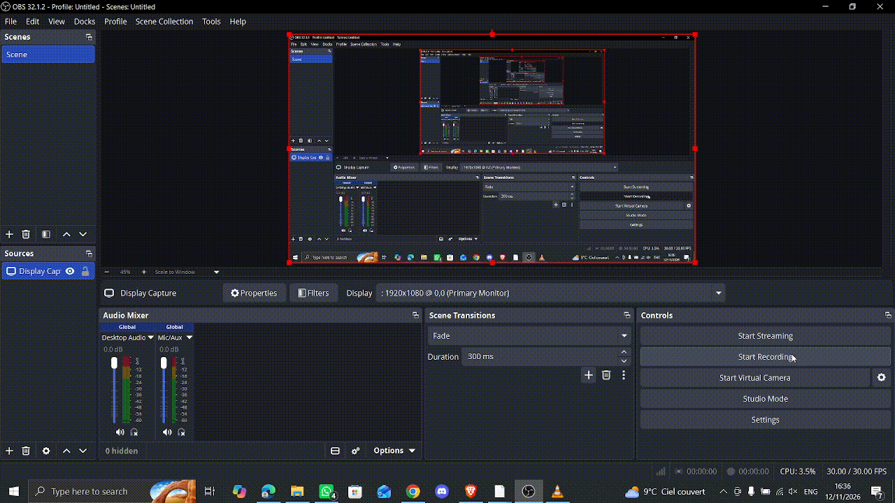

<div align="center">

# Écran magique sur FPGA

**TP FPGA – Petit projet** · ENSEA · 2G2 TD1 TP1

*GARCIA Lucas · ZHAR Mohamed Reda*


</div>

---

## Sommaire

1. [Présentation](#1-présentation)
2. [Architecture générale](#2-architecture-générale)
3. [Gestion des encodeurs](#3-gestion-des-encodeurs)
4. [Contrôleur HDMI](#4-contrôleur-hdmi)
5. [Déplacement d'un pixel](#5-déplacement-dun-pixel)
6. [Mémorisation (framebuffer)](#6-mémorisation-framebuffer)
7. [Effacement de l'écran](#7-effacement-de-lécran)
8. [Bonus : effacer un trait en repassant dessus](#8-bonus--effacer-un-trait-en-repassant-dessus)
9. [Fichiers du projet](#9-fichiers-du-projet)
10. [Synthèse et utilisation](#10-synthèse-et-utilisation)
11. [Auteurs](#11-auteurs)

---

## 1. Présentation

Ce projet reproduit sur FPGA le jouet **« Écran magique »** (Etch A Sketch) : deux boutons rotatifs déplacent un point sur l'écran et laissent derrière lui un trait qui reste affiché.

Ici, les deux boutons sont les **deux encodeurs incrémentaux** de la carte mezzanine, et l'image est envoyée sur un écran via la sortie **HDMI** de la carte (transmetteur **ADV7513**), en **720 × 480 (480p)**.

| Commande | Action |
|---|---|
| Encodeur gauche (rotation) | Déplacement horizontal (abscisse *x*) |
| Encodeur droit (rotation) | Déplacement vertical (ordonnée *y*) |
| Bouton poussoir de l'encodeur gauche | Effacement complet de l'écran |
| Repassage sur un pixel déjà tracé | Le pixel s'éteint (fonction bonus) |
| `KEY0` | Reset |

Le projet est découpé en étapes successives, chacune validée sur la carte avant de passer à la suivante : encodeurs → HDMI → pixel mobile → mémoire → effacement → bonus.

---

## 2. Architecture générale

Le design utilise **deux domaines d'horloge** :

- **50 MHz** : horloge système (lecture des encodeurs, logique de tracé, effacement, port A de la RAM) ;
- **27 MHz** : horloge pixel fournie par une **PLL**, qui cadence le contrôleur HDMI, le port B de la RAM et l'ADV7513.

Le signal `locked` de la PLL sert de reset au contrôleur HDMI : celui-ci ne démarre qu'une fois la PLL verrouillée.

```
                    ┌──────────────┐
  LEFT_A/B ───────► │ encoder_     │── s_enc_x ──┐
                    │ counter (x)  │             │
                    └──────────────┘             │      ┌──────────────────┐
                           ▲ clk_en (1 kHz)      ├────► │ Logique de tracé │
                    ┌──────┴───────┐             │      │ (toggle, 2 cyc.) │
                    │ clock_enable │             │      └────────┬─────────┘
                    └──────┬───────┘             │               │ adresse / donnée / we
                           ▼ clk_en (1 kHz)      │               ▼
                    ┌──────────────┐             │      ┌──────────────────┐   ┌───────────┐
  RIGHT_A/B ──────► │ encoder_     │── s_enc_y ──┘      │ MUX port A       │◄──│ ram_clear │◄─ bouton
                    │ counter (y)  │                    │(effacement prio.)│   └───────────┘   gauche
                    └──────────────┘                    └────────┬─────────┘
                                                                 ▼  50 MHz
                                                        ┌──────────────────┐
                                                        │ dpram (1 bit     │
                                                        │ × 345 600)       │
                                                        └────────┬─────────┘
                                                                 ▼  27 MHz (port B, lecture)
  PLL ──► clk 27 MHz ──► ┌─────────────────┐  adresse   ┌──────────────────┐
                         │ hdmi_controler  │──────────► │ blanc / noir     │──► ADV7513 ──► HDMI
                         │ HS · VS · DE    │            │ (24 bits RGB)    │
                         └─────────────────┘            └──────────────────┘
```

---

## 3. Gestion des encodeurs

### Objectif

Lire un encodeur incrémental : un registre de taille configurable (`g_BITS = 10`) est **incrémenté** quand on tourne vers la droite et **décrémenté** vers la gauche. Sa valeur est affichée en binaire sur les 10 LED de la carte.

### Principe

Un encodeur délivre deux signaux **A** et **B en quadrature** (déphasés de 90°). Le sens de rotation se déduit de l'état d'une voie au moment d'un front de l'autre :

| Action | Condition 1 | Condition 2 |
|---|---|---|
| Incrémentation | front montant de A et B = 0 | front descendant de A et B = 1 |
| Décrémentation | front montant de B et A = 0 | front descendant de B et A = 1 |

### Détection de fronts

Chaque voie passe par **deux bascules D en cascade**, cadencées par la même horloge. En notant `q1` la sortie de la première bascule (valeur courante) et `q2` celle de la seconde (valeur précédente) :

- front montant : `q1 · /q2`
- front descendant : `/q1 · q2`

Comme A et B sont asynchrones par rapport à l'horloge, cet échantillonnage les **resynchronise** également.

### Équations logiques

```
inc = (Aq1 · /Aq2 · /Bq1) + (/Aq1 · Aq2 · Bq1)
dec = (/Aq1 · Bq1 · /Bq2) + ( Aq1 · /Bq1 · Bq2)
```

Soit, pour chaque sortie, **deux portes ET à trois entrées suivies d'une porte OU**, derrière **quatre bascules D** (deux par voie).

<div align="center">


*Schéma logique du décodeur de quadrature : quatre bascules D, quatre portes ET et deux portes OU produisant `inc` et `dec`.*
</div>

Les signaux `inc` et `dec` commandent un registre à `g_BITS` bits : **+1** si `inc = 1`, **−1** si `dec = 1`, inchangé sinon. Le compteur boucle naturellement modulo 2^`g_BITS` (0 à 1023 pour 10 bits).

### Implémentation VHDL

**Cadencement par `clock_enable`.** Les encodeurs étant mécaniques, leurs signaux présentent des **rebonds**. Plutôt que de créer une seconde horloge, le composant `clock_enable` génère une impulsion d'un cycle d'horloge tous les `g_DIVISOR` coups d'horloge. Avec `g_DIVISOR = 50 000` et une horloge de 50 MHz :

```
f_en = 50·10⁶ / 50 000 = 1 kHz        T_en = 1 ms
```

Les bascules et le compteur n'avancent que lorsque `i_clk_en = '1'` : les voies sont échantillonnées toutes les millisecondes, ce qui filtre les rebonds (plus rapides que 1 ms) tout en restant bien plus rapide que la rotation manuelle. Le reste du design reste sur l'horloge 50 MHz unique.

**Composant `encoder_counter`.** Il est décrit en trois blocs :

1. les registres à décalage `r_a_pipe` et `r_b_pipe` réalisent les quatre bascules D (bit 0 = `q1`, bit 1 = `q2`) ;
2. la logique combinatoire calcule `s_inc` et `s_dec` selon les équations ci-dessus ;
3. le compteur `r_counter` est mis à jour.

Un **reset asynchrone actif à l'état bas** (`i_rst_n`) initialise chaque registre, et la taille du compteur est paramétrée par le generic `g_BITS`.

**Intégration.** Dans le top-level de cette étape, `clock_enable` et `encoder_counter` sont instanciés, la sortie du compteur est reliée aux LED (`LEDR <= s_counter`) et le reset est assuré par le bouton `KEY0`.

### Test sur la carte

Le projet est synthétisé sous Quartus pour le FPGA **5CSEBA6U23I7**, avec les affectations de broches (`LEFT_A`, `LEFT_B`, `KEY0`, `LEDR[9:0]`). La valeur affichée sur les LED augmente quand on tourne l'encodeur gauche vers la droite et diminue vers la gauche.

---

## 4. Contrôleur HDMI

### Objectif

Générer, à partir de l'horloge pixel de **27 MHz** fournie par la PLL, les signaux de synchronisation **HS**, **VS** et **DE** attendus par l'ADV7513, ainsi que les compteurs `x`, `y` et l'adresse du pixel courant.

### Principe

Une image de **720 × 480 pixels** (480p) est balayée ligne par ligne. Autour de la zone active s'ajoutent des intervalles de suppression, dont les durées sont des *generics* du composant :

| | Synchro | Avant zone active | Arrière |
|---|---|---|---|
| Horizontal (périodes d'horloge) | `h_sync = 61` | `h_fp = 58` | `h_bp = 18` |
| Vertical (lignes) | `v_sync = 5` | `v_fp = 30` | `v_bp = 9` |

Zone active : `h_res = 720`, `v_res = 480`.

Deux compteurs cascadés, `r_h_count` (horizontal) et `r_v_count` (vertical), comptent de 0 à leur total (`h_total = 857`, `v_total = 524`), soit **858 périodes par ligne** et **525 lignes par image**. Le compteur vertical n'avance qu'à la fin de chaque ligne. La fréquence de rafraîchissement vaut :

```
f_image = 27·10⁶ / (858 × 525) ≈ 59,94 Hz
```

Les sorties sont déduites des compteurs :

- **HS** (resp. **VS**) est à l'état bas en début de ligne (resp. d'image), pendant la synchronisation, puis haut ;
- les registres `r_h_active` et `r_v_active` passent à `'1'` au début de la zone active et à `'0'` à sa fin ;
- **DE** (*Data Enable*) est le ET de ces deux registres, lui-même enregistré : il est donc **en retard d'un cycle** sur eux ;
- `x` et `y` valent 0 sur le premier pixel actif et `h_res − 1`, `v_res − 1` sur le dernier ; l'adresse du pixel est `x + y · h_res`.

Durées attendues :

| Grandeur | Valeur |
|---|---|
| Période d'une ligne | 858 cycles |
| Lignes par image | 525 |
| HS à l'état bas par ligne | 62 cycles |
| VS à l'état bas par image | 6 lignes |
| DE à l'état haut par ligne active | 720 cycles |
| Lignes actives par image | 480 |

### Implémentation VHDL

Le composant (`HDMI/hdmi_controler.vhd`) est décrit en **trois processus synchrones** (horizontal, vertical, DE) à reset asynchrone actif bas, plus des affectations combinatoires pour `x`, `y` et l'adresse. Une condition `when ... else 0` sur `x` et `y` évite des valeurs hors plage ; hors zone active ces valeurs ne sont pas utilisées.

### Intégration et test

Dans `telecran.vhd`, le contrôleur est instancié avec les generics ci-dessus, l'horloge `s_clk_27` et le reset `s_rst_n` issus de la PLL. Le même `s_clk_27` pilote l'horloge pixel de l'ADV7513 (`o_hdmi_tx_clk`), dont la configuration en 480p passe par le bus I²C (`I2C_HDMI_Config`).

Pour vérifier le contrôleur, les compteurs sont reliés aux couleurs :

```vhdl
o_hdmi_tx_d (23 downto 16) <= std_logic_vector ( to_unsigned ( s_x_counter, 8) );
o_hdmi_tx_d (15 downto 8)  <= std_logic_vector ( to_unsigned ( s_y_counter, 8) );
o_hdmi_tx_d (7 downto 0)   <= ( others => '0' );
```

Le bus `o_hdmi_tx_d` est un bus **RGB 24 bits** : bits 23→16 = rouge, 15→8 = vert, 7→0 = bleu (8 bits, soit 256 niveaux, par composante). Ici le rouge dépend de `x`, le vert de `y`, le bleu est nul.

**Résultat.** `to_unsigned(..., 8)` ne conserve que les 8 bits de poids faible : le dégradé se **répète tous les 256 pixels** dans chaque direction, et l'écran apparaît découpé en rectangles (720 = 2 × 256 + 208 en largeur, 480 = 256 + 224 en hauteur). Dans chaque rectangle, le rouge croît vers la droite et le vert vers le bas :

| Coin | Couleur (R, G, B) |
|---|---|
| Supérieur gauche | noir (0, 0, 0) |
| Supérieur droit | rouge (255, 0, 0) |
| Inférieur gauche | vert (0, 255, 0) |
| Inférieur droit | jaune (255, 255, 0) |

Les rectangles de la dernière colonne et de la dernière ligne sont tronqués (le rouge s'arrête à 207, le vert à 223). Cela confirme le bon fonctionnement des compteurs `x`, `y` et du bus RGB.


---

## 5. Déplacement d'un pixel

### Objectif

Afficher **un seul pixel blanc sur fond noir**, dont la position est pilotée par les deux encodeurs : l'encodeur gauche gère l'abscisse, l'encodeur droit l'ordonnée.

### Principe

Le contrôleur HDMI fournit à chaque instant les coordonnées `(x_hdmi, y_hdmi)` du pixel en cours d'affichage ; les deux compteurs d'encodeurs fournissent la position voulue `(x_enc, y_enc)`. Le pixel est blanc lorsque les deux couples sont égaux :

```
pixel(x_hdmi, y_hdmi) = x"FFFFFF"  si x_hdmi = x_enc  et  y_hdmi = y_enc
                      = x"000000"  sinon
```

C'est de la logique purement combinatoire : deux comparateurs d'égalité, une porte ET et un multiplexeur 24 bits.

### Implémentation VHDL

Deux instances de `encoder_counter` (une par encodeur, 10 bits, cadencées par le même `clock_enable` à 1 kHz) produisent `s_enc_x` et `s_enc_y` :

```vhdl
o_hdmi_tx_d <= x"FFFFFF" when ( s_x_counter = to_integer ( unsigned ( s_enc_x ) ) )
                           and ( s_y_counter = to_integer ( unsigned ( s_enc_y ) ) )
               else x"000000";
```

### Remarques

- Les compteurs d'encodeurs vont de 0 à 1023 alors que l'écran ne fait que 720 × 480 : si `x_enc ≥ 720` ou `y_enc ≥ 480`, aucune égalité n'est vraie et le pixel n'est simplement pas affiché.
- Les encodeurs étant échantillonnés à 1 kHz, la position change au plus d'un cran par milliseconde : le pixel suit la rotation sans perte.
- Ici `o_hdmi_tx_d` dépend directement des compteurs alors que `DE` est enregistré (retard d'un cycle) : l'image est décalée d'un pixel, sans conséquence pour un pixel isolé. Cette latence est compensée naturellement dans la version avec mémoire.

<div align="center">


*Apparition du pixel blanc (indiqué par la flèche) qui se déplace à l'écran.*
</div>

---

## 6. Mémorisation (framebuffer)

### Objectif

Conserver les pixels parcourus pour que le dessin reste affiché. Il faut pour cela un **framebuffer** : une mémoire qui contient l'état de chaque pixel de l'écran.

### Mémoire dual-port

Une mémoire dual-port possède deux ports indépendants, chacun avec sa propre horloge, son bus d'adresse, son bus de données, son signal d'écriture (`we`) et sa sortie de lecture. C'est exactement ce qu'il faut ici, car le dessin et l'affichage évoluent en parallèle dans deux domaines d'horloge :

| Port | Horloge | Rôle |
|---|---|---|
| **A** | 50 MHz | Écriture des pixels aux coordonnées données par les encodeurs |
| **B** | 27 MHz (horloge pixel) | Lecture, à l'adresse du pixel que le contrôleur HDMI affiche |

Dans `dpram.vhd`, chaque port est un processus synchrone : en cas d'écriture, la donnée est stockée et la sortie `o_q` est mise à jour au coup d'horloge suivant. **La lecture a donc une latence d'un cycle.**

> ⚠️ Le port B doit être en **lecture seule** : `i_we_b` vaut `'1'` par défaut dans `dpram` et doit être forcé à `'0'`, sinon chaque pixel affiché écraserait la mémoire.

### Dimensionnement

Un pixel n'a que deux états (noir ou blanc) : `data_width = 1` et `mem_size = h_res × v_res = 345 600` mots, soit **345 600 bits**. Avec 8 bits par pixel, la mémoire serait huit fois plus grande (≈ 2,76 Mbits) pour un affichage identique. Cette taille tient dans quelques dizaines de blocs **M10K** du FPGA.

### Adressage

L'adresse d'un pixel est `addr = y · h_res + x`, aussi bien côté écriture (avec `x_enc`, `y_enc`) que côté lecture (adresse fournie par le contrôleur HDMI). Côté écriture, un pixel hors écran (`x_enc ≥ 720` ou `y_enc ≥ 480`) n'est jamais écrit : l'adresse est forcée à 0 et `we` est maintenu à 0.

### Écriture par basculement (toggle)

Une écriture n'a lieu que lorsque la **position de l'encodeur change** ; sinon le pixel serait réécrit en permanence et clignoterait sur place. La valeur écrite est l'**inverse** de la valeur stockée, lue sur le port A : un pixel éteint (0) passe à l'état allumé (1).

Comme la lecture de la RAM a une latence d'un cycle, l'écriture se fait **en deux temps** :

1. **cycle 1** : la position change ; le registre `r_toggle_pending` est armé et la RAM lit l'ancienne valeur du pixel sur `o_q_a` ;
2. **cycle 2** : `we = r_toggle_pending` (ET position à l'écran), la donnée écrite est `not o_q_a`, et la position courante est mémorisée dans `r_prev_x`, `r_prev_y`.

### Affichage

La sortie du port B commande directement la couleur : **blanc si le bit lu vaut 1, noir sinon**. La latence d'un cycle de la lecture compense exactement le décalage d'un cycle entre l'adresse (combinatoire) et `DE` (enregistré) : l'image est correctement alignée sans registre supplémentaire.

### Implémentation VHDL

Détection de changement de position, validité de l'adresse et calcul de l'adresse :

```vhdl
s_pos_changed <= '1' when ( s_enc_x /= r_prev_x ) or ( s_enc_y /= r_prev_y ) else '0';

s_pos_on_screen <= '1' when ( to_integer ( unsigned ( s_enc_x ) ) < h_res )
                        and ( to_integer ( unsigned ( s_enc_y ) ) < v_res )
                   else '0';

process ( s_enc_x, s_enc_y )
begin
  if ( to_integer ( unsigned ( s_enc_x ) ) < h_res )
     and ( to_integer ( unsigned ( s_enc_y ) ) < v_res ) then
    s_fb_addr <= to_integer ( unsigned ( s_enc_y ) ) * h_res
               + to_integer ( unsigned ( s_enc_x ) );
  else
    s_fb_addr <= 0;
  end if;
end process;
```

Logique de tracé avec un cycle de retard :

```vhdl
process ( i_clk_50, s_rst_n )
begin
  if ( s_rst_n = '0' ) then
    r_prev_x <= ( others => '0' );
    r_prev_y <= ( others => '0' );
    r_toggle_pending <= '0';
  elsif rising_edge ( i_clk_50 ) then
    if ( r_toggle_pending = '1' ) then
      r_prev_x <= s_enc_x;
      r_prev_y <= s_enc_y;
      r_toggle_pending <= '0';
    elsif ( s_pos_changed = '1' ) then
      r_toggle_pending <= '1';
    end if;
  end if;
end process;

s_fb_we    <= r_toggle_pending and s_pos_on_screen;
s_fb_wdata <= (0 => not s_fb_qa (0));
```

Instanciation du framebuffer et génération des pixels :

```vhdl
u_framebuffer : entity work.dpram
  generic map ( mem_size => h_res * v_res, data_width => 1 )
  port map (
    i_clk_a  => i_clk_50,     i_clk_b  => s_clk_27,
    i_addr_a => s_fb_addr,    i_addr_b => s_pixel_addr,
    i_data_a => s_fb_wdata,   i_data_b => (0 => '0'),
    i_we_a   => s_fb_we,      i_we_b   => '0',          -- port B en lecture seule
    o_q_a    => s_fb_qa,      o_q_b    => s_fb_qb );

o_hdmi_tx_d <= x"FFFFFF" when ( s_fb_qb (0) = '1' ) else x"000000";
```

### Test sur la carte

Déplacer les encodeurs trace un trait blanc qui **reste affiché** à l'écran.

<div align="center">


*Tracé conservé en mémoire après déplacement des encodeurs.*
</div>

---

## 7. Effacement de l'écran

### Objectif

Effacer tout l'écran d'un simple appui sur le **bouton poussoir de l'encodeur gauche** : tous les pixels du framebuffer repassent à 0 (noir).

### Principe

La mémoire n'a pas de remise à zéro globale : il faut **parcourir toutes les adresses** de 0 à `h_res × v_res − 1 = 345 599` et y écrire un 0. Cela demande trois éléments :

1. **détecter l'appui** sur le bouton, sans rebonds et une seule fois par appui ;
2. un **compteur d'adresses**, piloté par une machine à deux états (repos / balayage) ;
3. un **multiplexeur sur le port A** de la RAM, déjà utilisé par le tracé : pendant le balayage, l'adresse, la donnée et le signal d'écriture viennent du compteur d'effacement, sinon de la logique de tracé. **L'effacement est prioritaire.**

Le port B n'est pas modifié : l'affichage continue de lire la mémoire pendant le balayage.

### Le composant `ram_clear`

Comme pour `clock_enable`, la logique d'effacement est isolée dans un composant dédié, `ram_clear`, instancié dans `telecran.vhd`. Il comporte **deux bascules D** qui échantillonnent le bouton, une **détection de front** et une **machine à états** :

| État | Condition de transition | Action | Sortie |
|---|---|---|---|
| `IDLE` | appui détecté → `CLEARING` | adresse remise à 0 | `o_busy = 0` |
| `CLEARING` | adresse = `g_MEM_SIZE − 1` → `IDLE` | adresse +1 à chaque cycle | `o_busy = 1` |

**Détection de l'appui.** Le bouton est actif à l'état bas (1 au repos, 0 à l'appui). Comme pour les encodeurs, il est échantillonné par deux bascules D validées par le `clock_enable` à 1 kHz, ce qui filtre les rebonds. Un appui correspond à un front descendant : `btnq1 = 0` et `btnq2 = 1`. Pendant le balayage, un nouvel appui est ignoré.

**Durée.** Le balayage écrit une adresse par cycle d'horloge 50 MHz :

```
345 600 × 20 ns = 6,912 ms
```

C'est moins d'une image à 60 Hz (16,7 ms) : l'effacement paraît **instantané**.

### Intégration dans `telecran.vhd`

Le fichier `ram_clear.vhd` est ajouté au projet Quartus (`Project > Add/Remove Files in Project`), ce qui revient à ajouter `set_global_assignment -name VHDL_FILE ram_clear.vhd` dans `telecran.qsf`. Le bouton `i_left_pb` est déjà affecté à la broche `PIN_AH27`.

Quatre modifications du top-level suffisent :

**1. Déclarer les signaux** de l'effacement et ceux appliqués au port A :

```vhdl
signal s_clr_busy   : std_logic;
signal s_clr_addr   : natural range 0 to ( h_res * v_res - 1 );
signal s_ram_addr_a : natural range 0 to ( h_res * v_res - 1 );
signal s_ram_data_a : std_logic_vector (0 downto 0);
signal s_ram_we_a   : std_logic;
```

**2. Instancier `ram_clear`** avec le bouton de l'encodeur gauche et le `clock_enable` existant :

```vhdl
u_ram_clear : entity work.ram_clear
  generic map ( g_MEM_SIZE => h_res * v_res )
  port map (
    i_clk    => i_clk_50,
    i_rst_n  => s_rst_n,
    i_clk_en => s_clk_en,
    i_btn_n  => i_left_pb,
    o_busy   => s_clr_busy,
    o_addr   => s_clr_addr
  );
```

**3. Multiplexer le port A** (effacement prioritaire) et relier ces signaux à `i_addr_a`, `i_data_a`, `i_we_a` du `dpram` :

```vhdl
s_ram_addr_a <= s_clr_addr when ( s_clr_busy = '1' ) else s_fb_addr;
s_ram_data_a <= "0"        when ( s_clr_busy = '1' ) else s_fb_wdata;
s_ram_we_a   <= '1'        when ( s_clr_busy = '1' ) else s_fb_we;
```

**4. Empêcher le tracé d'armer une écriture pendant le balayage :**

```vhdl
elsif ( s_pos_changed = '1' ) and ( s_clr_busy = '0' ) then
```

Cette dernière modification est nécessaire à cause de la lecture à un cycle de la RAM. Sans elle, une écriture de tracé armée juste avant la fin du balayage lirait `o_q_a` à l'adresse d'effacement et non à celle du pixel, et basculerait une valeur erronée. Une fois le balayage fini, la position de l'encodeur a changé par rapport à `r_prev_x` / `r_prev_y` : le tracé reprend normalement sur le pixel courant.

### Test sur la carte

Après avoir tracé un dessin, un appui sur le bouton de l'encodeur gauche **efface l'écran**, et le tracé peut reprendre immédiatement.

---

## 8. Bonus : effacer un trait en repassant dessus

### Objectif

Fonction non imposée par le sujet : **repasser sur un pixel déjà tracé l'éteint**, de sorte qu'on peut gommer un trait en le suivant à l'envers avec l'encodeur, sans effacer tout l'écran.

### Principe

Dans une version de base, chaque pixel visité est écrit à 1. Pour pouvoir l'éteindre, la valeur écrite dépend de ce qui est déjà en mémoire : on écrit l'**inverse** de la valeur stockée (*toggle*) :

- pixel éteint (0) → on écrit 1 : le pixel est **tracé** ;
- pixel allumé (1) → on écrit 0 : le pixel est **effacé**.

Il s'agit d'une opération **lecture–modification–écriture** sur le port A de la RAM, séquencée sur deux cycles grâce à `r_toggle_pending` (voir [section 6](#6-mémorisation-framebuffer)) :

1. **cycle 1** : la position de l'encodeur a changé (`s_pos_changed = 1`). L'adresse du nouveau pixel est présentée à la RAM, qui lit l'ancienne valeur ; `r_toggle_pending` est armé ;
2. **cycle 2** : `o_q_a` contient l'ancienne valeur. On active `we` et on écrit `not o_q_a` ; la position courante est mémorisée dans `r_prev_x`, `r_prev_y`, ce qui désarme la détection.

La comparaison de la position courante avec `r_prev_x` / `r_prev_y` garantit qu'**un pixel n'est basculé qu'une seule fois par déplacement** : sans elle, le pixel sous le curseur serait réécrit à chaque cycle et clignoterait. Seuls les pixels de l'écran sont écrits (`x_enc < 720` et `y_enc < 480`).

### Implémentation VHDL

La logique tient en deux lignes autour du processus de tracé :

```vhdl
s_fb_we    <= r_toggle_pending and s_pos_on_screen;
s_fb_wdata <= (0 => not s_fb_qa (0));   -- inverse de la valeur stockée
```

`s_fb_qa` est la sortie du port A de la RAM. Le processus qui arme `r_toggle_pending` est celui de la partie mémorisation, complété dans la partie effacement pour ne pas armer d'écriture pendant l'effacement complet.

### Comportement

Le basculement s'applique **au pixel sur lequel on arrive**. Exemple, en allant de x = 0 à x = 2 puis en revenant à x = 1 (y constant) :

| Étape | Mouvement | Pixel basculé | Nouvelle valeur |
|---|---|---|---|
| 1 | x : 0 → 1 | 1 | 1 (tracé) |
| 2 | x : 1 → 2 | 2 | 1 (tracé) |
| 3 | x : 2 → 1 (repassage) | 1 | 0 (effacé) |

En revenant en arrière, les pixels s'éteignent donc un par un, mais le pixel que l'on vient de quitter (ici le pixel 2) reste allumé jusqu'à ce qu'on y repasse.

### Démonstration

On trace un trait avec l'encodeur, puis on revient en arrière sur ce trait : les pixels traversés s'éteignent.

<div align="center">


*Démonstration sur carte de la fonction d'effacement par repassage.*
</div>

Une version vidéo complète (`.mp4`) est également disponible dans le dossier [`media/`](media/).

---

## 9. Fichiers du projet

| Fichier | Rôle |
|---|---|
| `telecran.vhd` | Top-level : PLL, encodeurs, contrôleur HDMI, framebuffer, tracé, effacement |
| `encoder_counter.vhd` | Décodeur de quadrature (4 bascules D) + compteur `g_BITS` bits haut/bas |
| `clock_enable.vhd` | Générateur d'impulsion d'activation (1 kHz avec `g_DIVISOR = 50 000`) |
| `HDMI/hdmi_controler.vhd` | Contrôleur HDMI : HS, VS, DE, `x`, `y`, adresse pixel |
| `dpram.vhd` | Mémoire double port (ports A et B, horloges indépendantes) |
| `ram_clear.vhd` | Détection d'appui + machine à états + compteur d'adresses d'effacement |
| `I2C_HDMI_Config` | Configuration de l'ADV7513 en 480p via le bus I²C |
| `telecran.qsf` | Projet Quartus : affectations de broches et liste des fichiers |
| `media/` | Images, GIF et vidéo utilisés dans ce document |

### Paramètres principaux

| Paramètre | Valeur | Rôle |
|---|---|---|
| `g_BITS` | 10 | Largeur des compteurs d'encodeurs (0 à 1023) |
| `g_DIVISOR` | 50 000 | Division de l'horloge 50 MHz → 1 kHz |
| `h_res` × `v_res` | 720 × 480 | Résolution de l'image |
| `mem_size` | 345 600 | Nombre de pixels (= bits) du framebuffer |
| `data_width` | 1 | 1 bit par pixel (noir / blanc) |

---

## 10. Synthèse et utilisation

1. Ouvrir le projet dans **Quartus** et vérifier que `ram_clear.vhd` et tous les fichiers VHDL du dépôt sont présents dans le projet.
2. Cible : FPGA **5CSEBA6U23I7** avec les affectations de broches du fichier de contraintes (`LEFT_A`, `LEFT_B`, `KEY0`, `LEDR[9:0]`, `i_left_pb` sur `PIN_AH27`, sorties HDMI).
3. Lancer la compilation, puis programmer la carte.
4. Brancher la sortie HDMI sur un écran (ou une capture vidéo).
5. Dessiner :
   - **Encodeur gauche** : déplacement horizontal ;
   - **Encodeur droit** : déplacement vertical ;
   - **Appui sur l'encodeur gauche** : effacement de tout l'écran ;
   - **Repasser sur un trait** : l'effacer pixel par pixel ;
   - **`KEY0`** : reset.

---

## 11. Auteurs

- **GARCIA Lucas**
- **ZHAR Mohamed Reda**

ENSEA – École Nationale Supérieure de l'Électronique et de ses Applications · 2G2 TD1 TP1

Dépôt : <https://github.com/MohamedReda2003/FPGA-Tutorials/tree/main/telecran>
